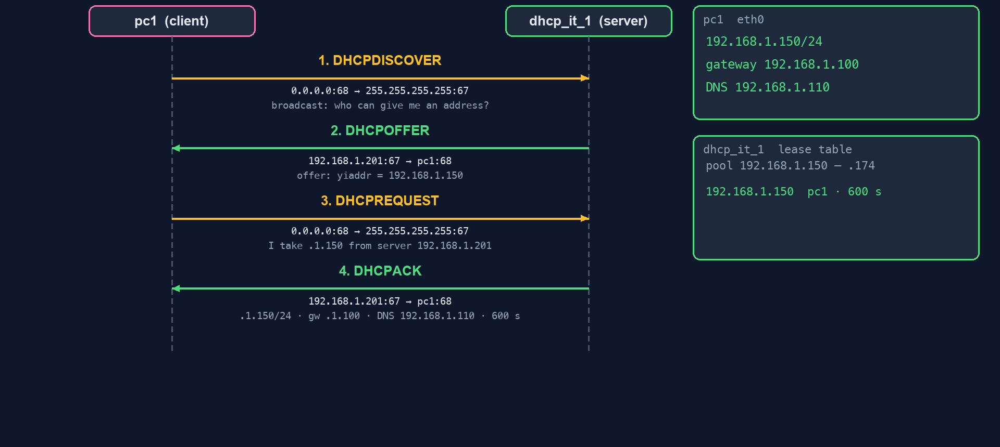
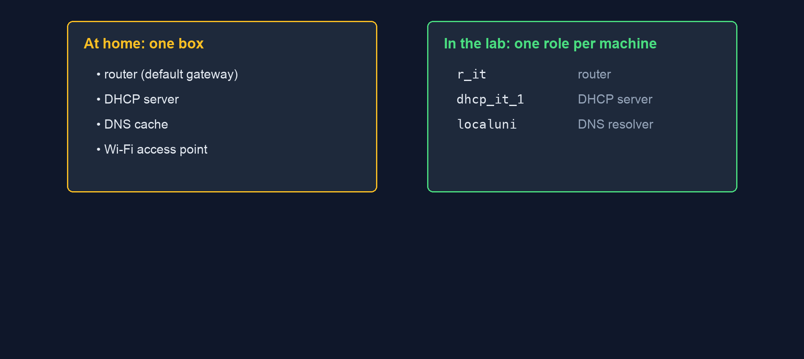
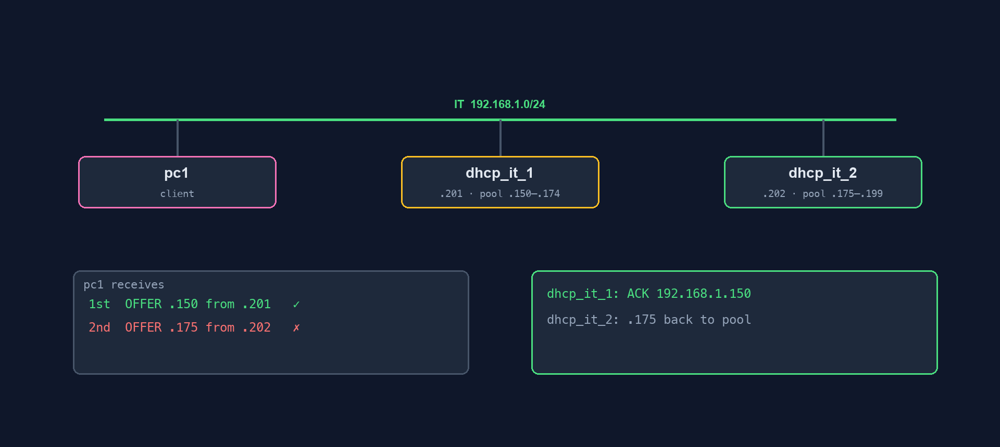
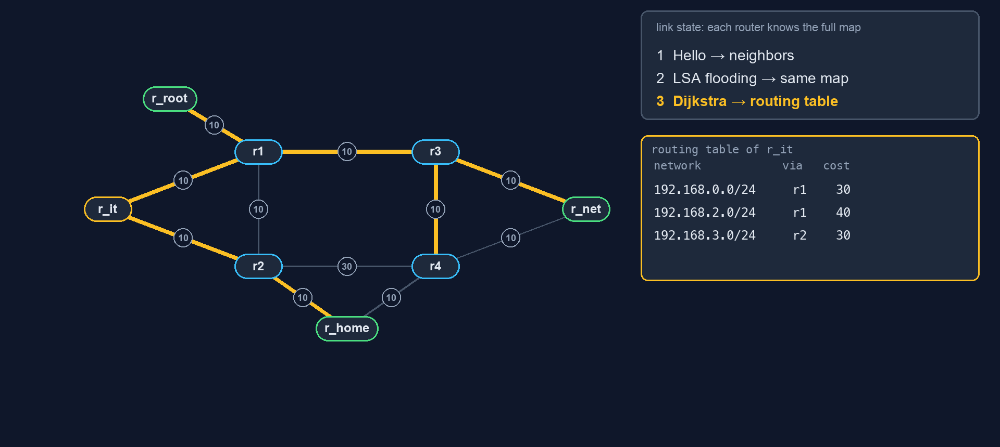
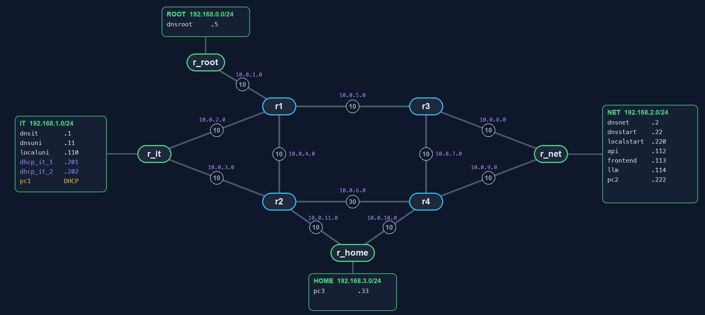
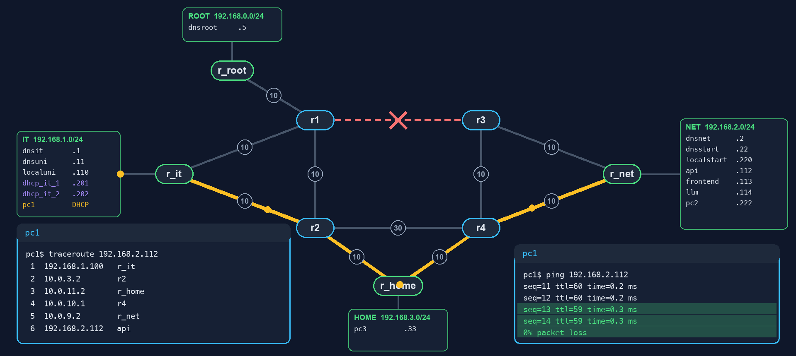
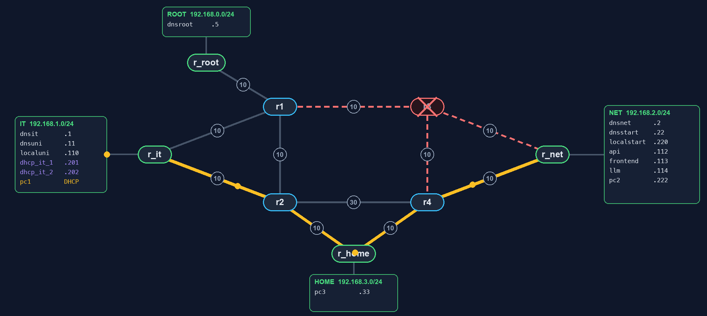

# OSPF e DHCP

Indirizzi automatici, routing automatico, guasti

---

## Setup

```bash
cd /tmp
git clone https://github.com/Marrocco-Simone/reti-lab-kathara
cd reti-lab-kathara/lab6-ospf-dhcp
./start-lab.sh
```

Al primo avvio Kathara scarica da `ghcr.io` le immagini `api`, `frontend`, `llm` e la nuova immagine `dhcp`

**Attenzione**: `/tmp` viene cancellata allo spegnimento del PC. Copiate altrove i file che modificate!

---

## Dove eravamo: lezione 5

Ogni indirizzo e ogni route scritti a mano nei `.startup`:

```bash
# r_home.startup (lezione 5): 6 route statiche solo qui
ip route add 192.168.0.0/24 via 192.168.40.1
ip route add 192.168.1.0/24 via 192.168.40.1
ip route add 192.168.2.0/24 via 192.168.50.2
...
```

- 4 router × ~6 route = ~24 righe da tenere corrette
- Se un link cade, le route statiche **non cambiano**: i pacchetti vanno verso il link morto e si perdono

---

## Oggi

1. **DHCP**: pc1 riceve IP, gateway e DNS in automatico
2. **OSPF**: i router costruiscono da soli le tabelle di routing
3. **Guasti**: tagliamo un link, facciamo "morire" un router, e guardiamo OSPF trovare un'altra strada

Stessi server e stesse LAN delle lezioni 4 e 5, ma **8 router**

---

## Wireshark su tutte le reti

`start-lab.sh` collega Wireshark (http://localhost:3000) a tutte le 15 reti:

| eth | Rete | eth | Rete | eth | Rete |
| --- | ---- | --- | ---- | --- | ---- |
| eth1 | ROOT | eth6 | LINK_IT_1 | eth11 | LINK_3_4 |
| eth2 | IT | eth7 | LINK_IT_2 | eth12 | LINK_3_NET |
| eth3 | NET | eth8 | LINK_1_2 | eth13 | LINK_4_NET |
| eth4 | HOME | eth9 | LINK_1_3 | eth14 | LINK_4_HOME |
| eth5 | LINK_ROOT_1 | eth10 | LINK_2_4 | eth15 | LINK_2_HOME |

Filtri utili: `dhcp`, `ospf`, `icmp`

---

<!-- _class: lead -->

# DHCP

Dynamic Host Configuration Protocol

---

## Cosa fa DHCP

<style scoped>section{font-size:26px}</style>

Un host nuovo non ha indirizzo IP: lo chiede a un server DHCP

Il server risponde con:

- **indirizzo IP e netmask** (es. `192.168.1.150/24`)
- **default gateway** (es. `192.168.1.100`)
- **server DNS** (es. `192.168.1.110`)
- **lease time**: per quanto tempo l'indirizzo è valido

Viaggia su **UDP**: client porta **68**, server porta **67**

Il server DHCP **non è** il gateway: comunica solo al client l'indirizzo del gateway

---

## Lo scambio DORA



Discover e Request sono **broadcast**: il client non ha ancora un indirizzo

---

## Il lease

- Il lease è **temporaneo** (nel lab: 600 secondi)
- A metà del lease (T1 = 50%) il client chiede il rinnovo
- Se l'host sparisce, l'indirizzo torna libero nel **pool** del server

```bash
# sul server: i lease assegnati
cat /var/lib/dhcp/dhcpd.leases
# sul client: il lease ricevuto
cat /var/lib/dhcp/dhclient.leases
```

---

## A casa: una scatola sola



Il router di casa è insieme gateway, server DHCP, cache DNS e access point Wi-Fi. Nel lab ogni ruolo è una macchina separata

---

## Il server DHCP del lab

<style scoped>table{font-size:22px} p{font-size:24px}</style>

| Server      | Rete | IP              | Pool          | Gateway | DNS             | Domain name   |
| ----------- | ---- | --------------- | ------------- | ------- | --------------- | ------------- |
| `dhcp_it_1` | IT   | `192.168.1.201` | `.150 - .174` | `.100`  | `192.168.1.110` | `uniroma3.it` |

Solo `pc1` usa DHCP. `pc2`, `pc3` e i server (DNS, `api`, `frontend`, `llm`, `dhcp_it_1`) hanno IP **statico** come nella lezione 5: gli altri host devono sapere dove trovarli

---

## DHCP in Kathara: l'immagine

`kathara/base` **non** contiene `isc-dhcp-server`. Usiamo la nostra immagine:

```conf
# lab.conf
dhcp_it_1[0]="IT"
dhcp_it_1[image]="ghcr.io/marrocco-simone/reti-lab-kathara:dhcp"
```

È `kathara/base` + il pacchetto `isc-dhcp-server` (Dockerfile in `images/dhcp/`)

---

## DHCP in Kathara: la configurazione

```conf
# dhcp_it_1/etc/dhcp/dhcpd.conf
default-lease-time 600;
max-lease-time 7200;

subnet 192.168.1.0 netmask 255.255.255.0 {
  range 192.168.1.150 192.168.1.174;
  option routers 192.168.1.100;
  option domain-name-servers 192.168.1.110;
  option domain-name "uniroma3.it";
}
```

```conf
# dhcp_it_1/etc/default/isc-dhcp-server
INTERFACESv4="eth0"
```

---

## DHCP in Kathara: i `.startup`

```bash
# dhcp_it_1.startup
ip address add 192.168.1.201/24 dev eth0
ip route add default via 192.168.1.100 dev eth0

systemctl start isc-dhcp-server
```

```bash
# pc1.startup: nessun indirizzo, nessun gateway, nessun DNS
dhclient eth0
```

---

## Verifica sul client

```bash
pc1$ ip -4 -br addr show eth0
eth0             UP             192.168.1.150/24

pc1$ ip route
default via 192.168.1.100 dev eth0
192.168.1.0/24 dev eth0 proto kernel scope link src 192.168.1.150

pc1$ cat /etc/resolv.conf
domain uniroma3.it
search uniroma3.it
nameserver 192.168.1.110
```

Per rifare lo scambio: `dhclient -r eth0` (rilascia) e poi `dhclient -v eth0`

---

## Due server DHCP nella stessa LAN



Il client prende la **prima** Offer. La Request (broadcast) nomina il server scelto: l'altro rimette l'indirizzo nel pool

---

## Due server DHCP nella stessa LAN

- I **pool non devono sovrapporsi**: altrimenti due server possono dare lo stesso IP a due host
- Nella rete IT: `dhcp_it_1` dà `.150-.174`, il nuovo `dhcp_it_2` dà `.175-.199`
- Su Wireshark, interfaccia **eth2** (rete IT), filtro `dhcp`: vedete **due Offer** e **una sola Request**

---

## Creare `dhcp_it_2`

```conf
# lab.conf
dhcp_it_2[0]="IT"
dhcp_it_2[image]="ghcr.io/marrocco-simone/reti-lab-kathara:dhcp"
```

```bash
# dhcp_it_2.startup
ip address add 192.168.1.202/24 dev eth0
ip route add default via 192.168.1.100 dev eth0

systemctl start isc-dhcp-server
```

File da creare: `dhcp_it_2/etc/dhcp/dhcpd.conf` (pool `192.168.1.175 - 192.168.1.199`, il resto uguale a `dhcp_it_1`) e `dhcp_it_2/etc/default/isc-dhcp-server`

---

## Un indirizzo già occupato

<style scoped>section{font-size:30px}</style>

Nuovo PC con IP **statico** `192.168.1.150`: il primo indirizzo del pool di `dhcp_it_1`

```conf
# lab.conf
pc10[0]="IT"
pc10[image]="kathara/base"
```

```bash
# pc10.startup
ip address add 192.168.1.150/24 dev eth0
ip link set eth0 up
route add default gw 192.168.1.100 dev eth0
```

Prima di una Offer, `dhcp_it_1` fa un **ping** all'indirizzo. pc10 risponde: `.150` diventa `abandoned` e il server offre `.151`

---

## Esercizio 1: DHCP

<style scoped>section{font-size:30px}</style>

1. Completate `dhcp_it_1/etc/dhcp/dhcpd.conf` (i commenti nel file vi dicono i valori)
2. Avviate il servizio in `dhcp_it_1.startup`
3. Mettete `dhclient eth0` in `pc1.startup`
4. Riavviate il lab e controllate `ip addr`, `ip route` e `/etc/resolv.conf` su pc1
5. Create `dhcp_it_2` (slide "Creare `dhcp_it_2`") e riavviate il lab
6. Su pc1: `dhclient -r eth0` e `dhclient -v eth0`. Su Wireshark, interfaccia **eth2** (rete IT), filtro `dhcp`: trovate le due Offer
7. Aggiungete `pc10` (slide precedente) e riavviate il lab. Quale indirizzo offre `dhcp_it_1` a pc1? Su `dhcp_it_1`: `cat /var/lib/dhcp/dhcpd.leases`

---

<!-- _class: lead -->

# OSPF

Open Shortest Path First

---

## OSPF: l'idea

Protocollo **link state**:

- ogni router impara la **mappa completa** della rete
- ogni router calcola da solo le sue route con **Dijkstra**
- esattamente quello che avete fatto a mano nella lezione 5

Nessuna route statica: se la rete cambia, i router ricalcolano

---

## OSPF in tre passi

1. **Hello**: ogni 10 s ogni router manda un Hello su ogni interfaccia. Due router che si sentono diventano **vicini**. Nessun Hello per 40 s (dead interval) → il vicino è morto
2. **LSA flooding**: ogni router descrive i suoi link e i loro costi in un **Link State Advertisement** e lo manda a tutti i vicini, che lo inoltrano. Alla fine tutti hanno lo stesso database
3. **Dijkstra**: ogni router calcola l'albero dei cammini minimi da sé stesso e scrive la tabella di routing

---

## Cosa c'è in un Hello

<style scoped>table{font-size:26px} p{font-size:26px}</style>

| Campo | Valore nel lab | A cosa serve |
| ----- | -------------- | ------------ |
| Router ID, Area ID | `1.1.1.1`, `0.0.0.0` | chi manda e in quale area |
| Network mask | `255.255.255.0` | deve essere uguale ai due lati |
| Hello interval, Dead interval | 10 s, 40 s | devono essere uguali ai due lati |
| Priority, DR, BDR | 1, ... | elezione del router "designato" del link |
| Neighbors | i Router ID già sentiti | se vedo **il mio** ID: siamo vicini (2-Way) |

Inviato a `224.0.0.5` (tutti i router OSPF), protocollo IP 89. Wireshark: interfaccia **eth6** (`LINK_IT_1`), filtro `ospf`

---

## Cosa c'è in un LSA

<style scoped>table{font-size:26px} p, li{font-size:26px}</style>

Gli LSA viaggiano dentro pacchetti **Link State Update**. Ogni LSA ha:

| Campo | A cosa serve |
| ----- | ------------ |
| Advertising router | chi lo ha creato (es. `1.1.1.1`) |
| Sequence number | il numero più alto vince: così si scarta un LSA vecchio |
| Age | dopo 3600 s l'LSA scade. Il creatore lo rinnova ogni 30 min |
| Link (solo Router LSA) | per ogni link del router: tipo, Link ID, Link Data e **costo** |

- **Router LSA** (tipo 1): ogni router elenca i suoi link e i loro costi
- **Network LSA** (tipo 2): il router designato di un link elenca i router collegati

---

## OSPF: la tabella di r_it



---

## La rete del lab



---

## Le reti di collegamento

<style scoped>table{font-size:17px} p{font-size:22px}</style>

| Rete          | Subnet         | Estremi              | Costo  |
| ------------- | -------------- | -------------------- | ------ |
| `LINK_ROOT_1` | `10.0.1.0/24`  | r_root .1 ↔ r1 .2    | 10     |
| `LINK_IT_1`   | `10.0.2.0/24`  | r_it .1 ↔ r1 .2      | 10     |
| `LINK_IT_2`   | `10.0.3.0/24`  | r_it .1 ↔ r2 .2      | 10     |
| `LINK_1_2`    | `10.0.4.0/24`  | r1 .1 ↔ r2 .2        | 10     |
| `LINK_1_3`    | `10.0.5.0/24`  | r1 .1 ↔ r3 .2        | 10     |
| `LINK_2_4`    | `10.0.6.0/24`  | r2 .1 ↔ r4 .2        | **30** |
| `LINK_3_4`    | `10.0.7.0/24`  | r3 .1 ↔ r4 .2        | 10     |
| `LINK_3_NET`  | `10.0.8.0/24`  | r3 .1 ↔ r_net .2     | 10     |
| `LINK_4_NET`  | `10.0.9.0/24`  | r4 .1 ↔ r_net .2     | 10     |
| `LINK_4_HOME` | `10.0.10.0/24` | r4 .1 ↔ r_home .2    | 10     |
| `LINK_2_HOME` | `10.0.11.0/24` | r2 .1 ↔ r_home .2    | 10     |

LAN: `192.168.x.0/24`, link tra router: `10.0.x.0/24`

---

## Le interfacce dei router

```
r_root  eth0 192.168.0.100 ROOT     eth1 10.0.1.1 LINK_ROOT_1
r_it    eth0 192.168.1.100 IT       eth1 10.0.2.1 LINK_IT_1
                                    eth2 10.0.3.1 LINK_IT_2
r_net   eth0 192.168.2.100 NET      eth1 10.0.8.2 LINK_3_NET
                                    eth2 10.0.9.2 LINK_4_NET
r_home  eth0 192.168.3.100 HOME     eth1 10.0.10.2 LINK_4_HOME
                                    eth2 10.0.11.2 LINK_2_HOME
r1  eth0 10.0.1.2 LINK_ROOT_1   eth1 10.0.2.2 LINK_IT_1
    eth2 10.0.4.1 LINK_1_2      eth3 10.0.5.1 LINK_1_3
r2  eth0 10.0.3.2 LINK_IT_2     eth1 10.0.4.2 LINK_1_2
    eth2 10.0.6.1 LINK_2_4      eth3 10.0.11.1 LINK_2_HOME
r3  eth0 10.0.5.2 LINK_1_3      eth1 10.0.7.1 LINK_3_4
    eth2 10.0.8.1 LINK_3_NET
r4  eth0 10.0.6.2 LINK_2_4      eth1 10.0.7.2 LINK_3_4
    eth2 10.0.9.1 LINK_4_NET    eth3 10.0.10.1 LINK_4_HOME
```

Gli indirizzi sono già nei `.startup` dei router

---

## OSPF in Kathara: l'immagine e i demoni

<style scoped>section{font-size:30px}</style>

```conf
# lab.conf
r2[image]="kathara/frr"
```

**FRR** è una suite di routing per Linux. In `r2/etc/frr/daemons` attivate OSPF:

```conf
ospfd=yes
```

Il file elenca **tutti** i protocolli di FRR (`bgpd`, `ripd`, `isisd`, ...), tutti a `no`, e le opzioni di ogni demone. Cambiamo solo `ospfd=no` in `ospfd=yes`. `zebra` (scrive le route nel kernel) parte sempre

Il file completo è già in `r2/`: copiatelo negli altri router

---

## OSPF in Kathara: frr.conf

<style scoped>section{font-size:26px}</style>

In Kathara ogni interfaccia ha **costo 10** di default. Scrivete solo i costi diversi:

```conf
! r2/etc/frr/frr.conf
interface eth2
 ip ospf cost 30
!
router ospf
 ospf router-id 2.2.2.2
 network 10.0.0.0/16 area 0
!
```

`network 10.0.0.0/16` copre tutti i link `10.0.x.0/24` del router

**Il costo vale in uscita**: mettetelo su entrambi i lati del link (anche `r4` eth0)

---

## frr.conf riga per riga

<style scoped>table{font-size:24px} p{font-size:24px}</style>

| Riga | Significato |
| ---- | ----------- |
| `! ...` | commento, e separatore tra blocchi |
| `interface eth2` | entra nella configurazione di `eth2` |
| `ip ospf cost 30` | costo di `eth2` = 30 al posto di 10 |
| `router ospf` | entra nella configurazione di OSPF |
| `ospf router-id 2.2.2.2` | nome univoco del router in OSPF. Non è un indirizzo da raggiungere |
| `network 10.0.0.0/16 area 0` | ogni interfaccia con un IP in `10.0.0.0/16` parla OSPF e la sua rete viene annunciata |
| `network 192.168.1.0/24 area 0` | (solo router di bordo) annuncia anche la LAN |

Ogni riga è un comando di `vtysh`: FRR legge il file come se lo scriveste nella shell del router. L'indentazione è solo per leggere meglio

---

## OSPF in Kathara: i router di bordo

I router con una LAN annunciano anche la loro rete `192.168.x.0/24`:

```conf
! r_it/etc/frr/frr.conf
router ospf
 ospf router-id 6.6.6.6
 network 10.0.0.0/16 area 0
 network 192.168.1.0/24 area 0
!
```

Router ID: `r1`…`r4` = `1.1.1.1`…`4.4.4.4`, `r_root` = `5.5.5.5`, `r_it` = `6.6.6.6`, `r_net` = `7.7.7.7`, `r_home` = `8.8.8.8`

---

## OSPF in Kathara: il `.startup`

```bash
# r2.startup
ip address add 10.0.3.2/24 dev eth0
ip address add 10.0.4.2/24 dev eth1
ip address add 10.0.6.1/24 dev eth2
ip address add 10.0.11.1/24 dev eth3

systemctl start frr
```

**Nessuna route statica**

---

## Esercizio 2: OSPF

`r2` è già completo. Per gli altri 7 router:

1. Copiate `r2/etc/frr/daemons`
2. Scrivete `etc/frr/frr.conf` (router-id, `network`, costo 30 solo su `r4` eth0)
3. Aggiungete `systemctl start frr` al `.startup`
4. Riavviate il lab e aspettate ~40 s

---

## Verifica: vtysh

<style scoped>section{font-size:30px}</style>

```bash
r_it$ vtysh -c "show ip ospf neighbor"
Neighbor ID  Pri State        Dead Time Address    Interface
1.1.1.1        1 Full/Backup    30.852s 10.0.2.2   eth1:10.0.2.1
2.2.2.2        1 Full/Backup    30.848s 10.0.3.2   eth2:10.0.3.1

r_it$ vtysh -c "show ip route ospf"
O>* 192.168.0.0/24 [110/30] via 10.0.2.2, eth1
O>* 192.168.2.0/24 [110/40] via 10.0.2.2, eth1
O>* 192.168.3.0/24 [110/30] via 10.0.3.2, eth2
...
```

`[110/40]`: 110 = distanza amministrativa di OSPF, 40 = costo del cammino

`vtysh` è la shell di FRR, simile a quella di un router Cisco. `-c "..."` esegue un solo comando. Senza `-c` si apre la shell: `show ...`, `configure terminal`, `exit`

---

## Verifica: traceroute

```bash
pc1$ traceroute -n 192.168.2.112
 1  192.168.1.100     # r_it
 2  10.0.2.2          # r1
 3  10.0.5.2          # r3
 4  10.0.8.2          # r_net
 5  192.168.2.112     # api
```

Costo: 10 + 10 + 10 + 10 (LAN NET) = **40**

Provate anche con i nomi: `curl http://frontend.startup.net/`

---

<!-- _class: lead -->

# Rompiamo la rete

---

## Test 1: cade un link

```bash
kathara connect r1
ip link set eth3 down       # spegniamo il link verso r3
```



---

## Test 1: cosa succede

<style scoped>section{font-size:30px}</style>

- `r1` vede subito l'interfaccia giù e manda un nuovo LSA
- Tutti ricalcolano Dijkstra: nuovo percorso `r_it, r2, r_home, r4, r_net`, costo 50
- Il traffico ora **attraversa il router HOME**
- `ping` da pc1 verso api durante il guasto: **0 pacchetti persi**, il TTL passa da 60 a 59
- `traceroute -n 192.168.2.112` da pc1: 6 hop invece di 5 (`10.0.3.2`, `10.0.11.2`, `10.0.10.1`, `10.0.9.2`)

```bash
# riparazione
ip link set eth3 up
```

---

## Vedere il flooding degli LSA

<style scoped>section{font-size:28px}</style>

Wireshark: interfaccia **eth6** (`LINK_IT_1`, tra `r_it` e `r1`), filtro `ospf.msg == 4` (solo **LS Update**)

1. Avviate la cattura, poi fate il Test 1 (`ip link set eth3 down` su `r1`)
2. Subito: `r1` manda un LS Update con il suo nuovo Router LSA, senza il link verso `r3`
3. Entro 40 s: `r3` non riceve più Hello da `r1`, lo dichiara morto e manda il suo LSA. Arriva un secondo LS Update
4. Aprite il pacchetto: `LS Update` → `Router-LSA` → Advertising Router, Sequence Number, elenco dei link con i costi

`ospf.msg == 5` mostra gli **LS Acknowledge**: ogni LSA ricevuto viene confermato. Nel Test 2 vedete gli LS Update di `r1`, `r4` e `r_net` dopo 40 s

---

## Test 2: un router muore in silenzio

<style scoped>p{font-size:26px}</style>

Prima: `traceroute -n 192.168.2.112` da pc1 deve passare di nuovo da r3 (`10.0.5.2`). Se non passa, aspettate 40 s o riavviate il lab

```bash
kathara connect r3
iptables -A OUTPUT -j DROP    # r3 non manda più niente
iptables -A FORWARD -j DROP   # e non inoltra più niente
```



---

## Test 2: cosa succede

<style scoped>section{font-size:30px}</style>

- `r3` non manda più Hello, ma i vicini **non lo sanno**
- Per il **dead interval** (40 s) continuano a mandargli pacchetti: persi
- Poi tolgono `r3`, mandano nuovi LSA e ricalcolano
- Nei nostri test: `ping` ogni secondo, **30-40 pacchetti persi**
- Dopo: `traceroute` da pc1 mostra lo stesso percorso del Test 1

```bash
# riparazione
iptables -F
```

Link giù: riparato subito. Router morto in silenzio: fino a 40 s

---

## Test 3: nessun link di riserva

```bash
# su r1: spegniamo l'unico link verso r_root
ip link set eth0 down
```

```bash
pc1$ ping 192.168.0.5
From 192.168.1.100 icmp_seq=1 Destination Net Unreachable
```

- ROOT è isolata: `dnsroot` non risponde e i nomi nuovi non si risolvono più
- OSPF trova solo i cammini che **esistono**: servono link ridondanti

Riparazione: `ip link set eth0 up` su r1

---


## Esercizio 3: guasti

1. `ping 192.168.2.112` da pc1 e, in un altro terminale, fate il Test 1. Quanti pacchetti perdete? Cambia il TTL?
2. Su Wireshark, interfaccia **eth8** (`LINK_1_2`, tra `r1` e `r2`), filtro `ospf`: trovate l'**LS Update** dopo il guasto
3. Rifate con il Test 2 e contate i pacchetti persi
4. Test 3: quali servizi smettono di funzionare?

---

<!-- _class: lead -->

# Extra

---

## Un progetto interessante: Pi-hole

- Un server DNS da mettere nella rete di casa (anche su un Raspberry Pi)
- Blocca i domini di pubblicità e tracciamento per **tutti** i dispositivi
- Può fare anche da **server DHCP** al posto del router
- Può usare come DNS upstream `1.1.1.1` (Cloudflare) invece del DNS dell'ISP

È il nostro `dhcp_it_1` + `localuni`, ma a casa vostra

---

## Server pubblici: il problema

Un dominio punta a un **IP pubblico fisso** (record A):

```
www.mioserver.it.   IN   A   203.0.113.10
```

Chiunque su Internet può mandare pacchetti a quell'IP, a ogni porta aperta

Ogni bug nel kernel o in un servizio esposto diventa una porta d'ingresso

---

## Esempio 1: "SSHHole" (5 novembre 2026)

OpenSSH su **Alpine Linux** (libc musl, senza PAM):

- Un account senza password ha `*` in `/etc/shadow` (su Alpine, `root` di default)
- L'attaccante manda una password di **257-1024 byte**
- `crypt()` di musl, con una chiave oltre 256 byte, restituisce `*` come errore
- `sshd` confronta `*` con `*` → **login riuscito**, al primo tentativo

Fix: OpenSSH 10.6p2, oppure `PasswordAuthentication no`

---

## Esempio 2: "NoisyTCP" (CVE-2026-99288)

Bug nel **kernel Linux**, nel codice TCP, presente dal 2015:

- Traffico TCP verso una qualsiasi porta in ascolto, **senza login**
- Una race condition nella ricerca dei socket (SYN cookie) → puntatore NULL
- **Kernel panic**: il server si spegne, con tutti i container sopra

Fix: aggiornare il kernel. Workaround: `sysctl -w net.ipv4.tcp_syncookies=0`

Due bug dello stesso mese: uno dà **accesso**, uno **spegne** il server

---

## Cloudflare Tunnel

```
  Utente ──► Cloudflare ◄══ tunnel (in uscita) ══ cloudflared ──► servizio
             (IP pubblico                          (sul vostro server,
              di Cloudflare)                        nessuna porta aperta)
```

- `cloudflared` apre una connessione **in uscita** verso Cloudflare
- Il DNS del dominio punta agli IP di Cloudflare: l'IP del server resta nascosto
- Il firewall può bloccare **tutto** il traffico in entrata
- Il servizio deve comunque avere la sua autenticazione

---

## Riassunto

- **DHCP**: DORA in broadcast, lease temporaneo, pool separati se ci sono più server
- **OSPF**: Hello → LSA → stesso database → Dijkstra su ogni router
- In Kathara: costo di default 10, si scrivono solo i costi diversi
- Un link giù si ripara subito; un router morto in silenzio richiede il dead interval
- Senza link ridondanti, nessun protocollo può salvarvi
